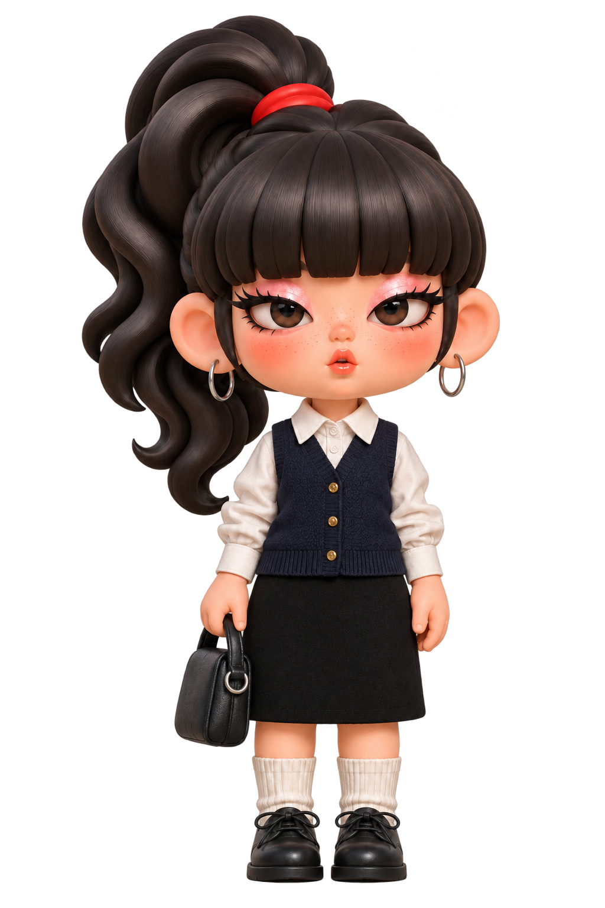

# 小林 · 3D 黏土插画素材

默认角色是 02 参考中的提包女生：白色翻领长袖衬衫、深蓝近黑针织马甲、黑裙、乳白罗纹袜、黑色系带鞋和黑色小手包。生成请求只说“小林 IP”时采用该全身站姿，不新增主题或道具。



默认交付真正带 Alpha 的透明 PNG。人物采用 3D 黏土柔光渲染，单人素材默认 2:3 竖版；有主题的配图可用 16:9 横版。用户明确的换装、动作、白底或场景要求优先。

## 安装

当前目录中的 `clay-character-illustrations` 是可安装技能；调用名为 `$clay-character-illustrations`。macOS / Linux 首次安装可执行：

```bash
mkdir -p "${CODEX_HOME:-$HOME/.codex}/skills"
cp -R ./clay-character-illustrations "${CODEX_HOME:-$HOME/.codex}/skills/"
```

已有同名技能时先备份并移出旧目录再安装，避免新旧文件混合。生成与编辑需要运行环境提供内置 `image_gen` 和参考图能力；没有图像工具时只能规划与编写提示词。

## 使用

```text
Use $clay-character-illustrations 生成小林 IP。
```

```text
Use $clay-character-illustrations 用小林表现“灵感枯竭”，透明底 PNG。
```

```text
Use $clay-character-illustrations 把这张图的小林换成红色套装，保留人物表情、动作、道具、构图和原有透明度。
```

## 维护

内置 13 张参考与示例：8 张角色图、3 张海报、1 张画风成图、1 张默认透明素材。02 是默认身份和穿搭，03 只辅助角度和比例，12 只约束渲染，13 展示透明交付。详细用途见 [图片索引](clay-character-illustrations/references/reference-index.md)。

修改身份、默认服装或画风时，同步 [角色定义](clay-character-illustrations/references/character-ip.md)、[关键词与标准模板](clay-character-illustrations/references/ip-keywords.md)、[画风定义](clay-character-illustrations/references/style-dna.md)、[prompt](clay-character-illustrations/references/prompt-template.md) 和 [验收清单](clay-character-illustrations/references/qa-checklist.md)。修改仓库或安装包不会自动同步到已安装副本。

## 验证与许可

已验证默认造型的实际透明 PNG；未覆盖全部角度、复杂姿势和换装组合，一致性需逐图检查。文本工作流改编自 [Ian 原项目](https://github.com/helloianneo/ian-xiaohei-illustrations)，保留 [MIT License](LICENSE) 和 [来源说明](clay-character-illustrations/NOTICE.md)。该文本许可不自动授予参考图片或其中其他素材的权利。
